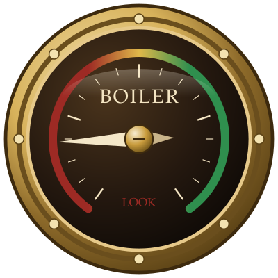
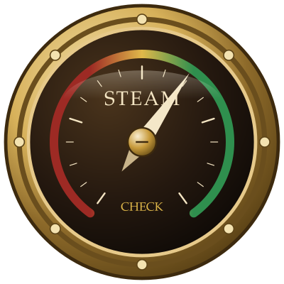
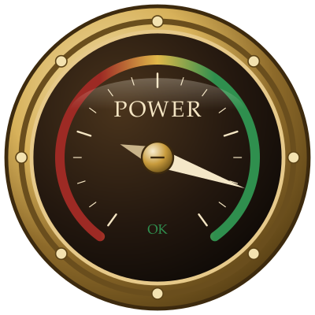
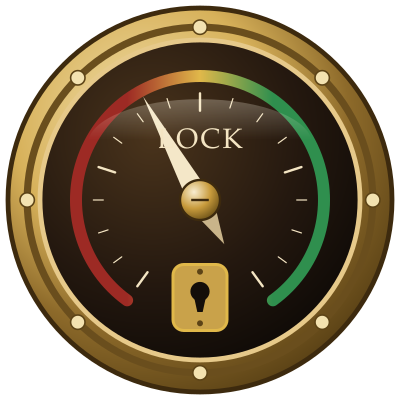

# SteamGuage

From NueM8 Studios: a round brass dial, riveted and glassed. The needle wakes at rest, then sweeps the arc as the boilers take up pressure. Red bids you LOOK. Yellow bids you CHECK. Green says the engine is OK. One plate keeps its counsel behind a keyhole, and the rim of that lock tells the same tale as the words.

The drawings are kept on [GitHub](https://github.com/Nuem8/SteamGuage). Further work from the shop is on the [NueM8 projects](https://nuem8.com/projects) page.

Copyright (C) 2026 NueM8 LLC. Developed by Kevin Roper.

SteamGauge is free software. You can redistribute it and modify it under the terms of the GNU General Public License version 3, published by the Free Software Foundation. See the `LICENSE` file.

SPDX-License-Identifier: GPL-3.0-only

Keep this copyright notice with any copy or modified version.

## Examples

These four gauges are the samples from `index.html`, drawn by `steamGauge.js` and saved in `assets`. The needle still follows the number. Warning readouts replace the digits with LOOK, CHECK, or OK. The lock readout draws a keyhole in that gap, and its rim uses the same zone color.

| BOILER, 18 — LOOK | STEAM, 62 — CHECK |
| --- | --- |
|  |  |
| The kettle sulks in the red. LOOK to the valves before the rivets sing. | Steam crowds the yellow band. CHECK the joints and mind the whistle. |

| POWER, 88 — OK | LOCK, 40 — keyhole |
| --- | --- |
|  |  |
| The engine sings in the green. Pressure is OK, and the brass may rest. | Brass warms around the keyhole. CHECK the ward, then try the key. |

Below 34 is LOOK, 34 to 66 is CHECK, and 67 and above is OK.

Open `index.html` to see each gauge start at zero and sweep to its number over one second. The page then moves one gauge every 3.5 seconds.

## Use

```html
<div class="steam-gauge" data-label="BOILER" data-value="18" data-size="280" data-readout="warning"></div>
<script src="steamGauge.js"></script>
```

`data-readout` may be `warning`, `keyhole`, or omitted for the number. `data-value` is a percent when it is above 1, or a fraction from 0 to 1. Call `setSteamGauge(element, 40)` to sweep from the current needle position to a new number.
